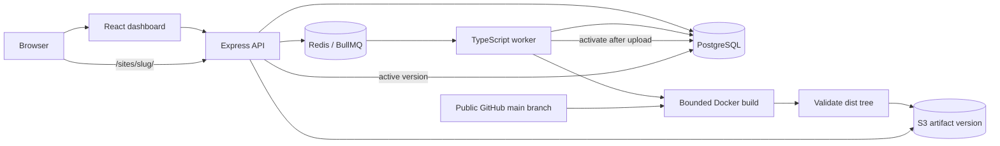

# Architecture

## Deployment lifecycle

1. The API validates a project name and public HTTPS GitHub URL. Repository credentials, arbitrary build commands, branch names, and output paths are not user inputs in this version.
2. PostgreSQL creates a stable deployment ID in `queued` state. That ID is also the BullMQ job ID. A dispatcher can reconstruct queued jobs from PostgreSQL when enqueueing did not complete.
3. A worker atomically claims a queued row as `building`. Existing non-queued rows are not started again by ordinary duplicate job delivery.
4. The worker creates a Docker container with a fresh `/work` volume and fixed image/commands. Checkout and build run inside that container. Platform database/S3 credentials and the Docker socket are not passed to it.
5. The worker copies `dist` out, validates its full file tree, requires `index.html`, rejects unsupported entries, and enforces file-count and byte limits. It uploads under the deployment's artifact prefix and verifies the uploaded files before activation.
6. After successful upload, the active site pointer changes and the deployment becomes `deployed`. An error becomes `failed` and leaves the prior pointer intact. Temporary workspaces and containers are cleaned on normal completion.
7. The API looks up the project's active deployment and serves objects from that artifact prefix. Incomplete new versions cannot become visible through the active site path before activation.

Milestone 1 uses last-successful-completion-wins ordering. Queue wait covers creation to claim; build duration covers claim to completion, including checkout, dependency installation, validation, and upload. These measurements describe different phases and must not be combined into a single build metric.

## Persistence boundaries

PostgreSQL is authoritative. Redis AOF retains queue data, but the queue is not the deployment-history database. Object storage is separate from both. Named volumes persist all three local services. No backup or retention guarantee is implemented.

Per-deployment prefixes avoid overwriting the live site's objects during another build. The initial version does not implement the full guarded ordering, rollback, claim expiry, or stale-worker fencing policy. A crash can strand a building row, leave a temporary container, or leave an incomplete unused artifact prefix. Do not manually republish a partially uploaded prefix.

## Build threat model

This is a local, single-operator demo for trusted repositories. A public repository is not inherently trustworthy. `npm ci` can execute install scripts, and `npm run build` executes repository code.

Default build limits are 1 CPU, 512 MiB memory, 128 PIDs, and 300 seconds for checkout, build, output copy, and upload, with concurrency 1. Upload requests use the remaining deadline as an abort signal; local output validation and final cleanup can extend total worker time. Output limits are 64 MiB and 5,000 files; persisted logs are capped at 1 MiB per deployment. Verify Docker's host-kernel resource support before relying on configured bounds. No measured capacity is implied.

Build containers receive no platform secrets or Docker socket. The worker needs the Docker socket to create them and therefore has privileged control over the Docker host. Run this platform on a dedicated development host. Builds can access the network; there is no hostile-code network isolation, VM boundary, checkout-size quota, or dependency disk quota. Container resource limits alone do not prove a secure sandbox.

The API has no authentication or ownership checks in milestone 1. Compose exposes its ports only on loopback. Do not publish this configuration to an untrusted network.

## Browser serving boundary

The first version uses `/sites/<slug>/` paths. Because those paths share the dashboard host, deployed documents receive a Content Security Policy sandbox without `allow-same-origin`. Static asset responses permit cross-origin loading so sandboxed JavaScript modules can load. The deployed document cannot use dashboard cookies, local storage, service workers, or same-origin browser APIs.

Repositories must build relative asset URLs. Extensionless site paths fall back to `index.html`; missing paths with file extensions return 404. Client-side routers still need the site's `/sites/<slug>/` base, and relative assets need care on nested routes. Hash routing is the simplest supported choice. Separate origins, host-based routing, and a new browser-isolation review belong to milestone 4.
