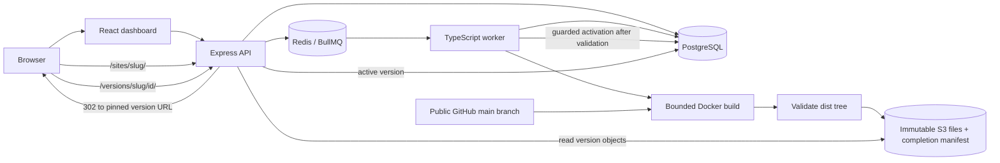

# Architecture

## Deployment lifecycle

1. The API validates a project name and public HTTPS GitHub URL. Repository credentials, arbitrary build commands, branch names, and output paths are not user inputs in this version.
2. PostgreSQL locks the project row, advances its publication generation, and creates a stable deployment ID in `queued` state with that generation. BullMQ jobs use `<deployment-id>-<expected-attempt>`. A dispatcher reconstructs ready queued work from PostgreSQL when scheduling did not complete.
3. A worker atomically claims the matching expected attempt as `building`, creates a UUID token, and records an expiring lease and a `build_attempts` row. Duplicate or stale deliveries cannot bypass the database's expected-attempt, status, retry-time, and attempt-limit checks.
4. The worker creates a token-specific Docker container and named `/work` volume with management labels and fixed image/commands. Checkout and build run inside that container. Platform database/S3 credentials and the Docker socket are not passed to it.
5. After the Docker build finishes and output is copied, the current lease holder records the Git SHA before upload. The worker validates `dist`, requires `index.html`, rejects unsupported entries and the reserved manifest name, and enforces file-count and byte limits. Files go under `deployments/<deployment-id>/attempts/<token>/` with conditional `If-None-Match: *` writes. The worker reads each uploaded object back and checks its actual byte length and SHA-256.
6. After every file passes, the worker writes `__shipyard_manifest.json` last, also without overwrite. New manifests contain `attemptId` and `commitSha` in addition to the deployment ID, file keys, sizes, SHA-256 values, and total bytes. A partial prefix without this marker is not a complete new version.
7. After normal build-resource cleanup, a transaction locks the project and deployment, checks the current unexpired claim token and pinned commit, changes the deployment from `building` to `deployed`, and stores the selected attempt's manifest. It changes the active pointer only if the project's generation still matches. A superseded successful build remains retained. A failed attempt preserves the pointer and either queues a bounded retry or ends the deployment as `failed`.
8. The active site route selects a deployment once and redirects to its immutable version path. Subsequent relative asset requests stay pinned to that version even when the active pointer changes.

`queueWaitMs` covers creation to the **first** claim. The API's `buildDurationMs` field covers first claim to final deployment completion, including checkout/install, validation/upload, cleanup, retry backoff, later queue waits, and downtime after a worker crash. Treat this as deployment elapsed time after the first claim, not pure build execution or CPU time. Per-attempt timestamps in `build_attempts` provide a separate operational timeline.

## Worker leases, retries, and cleanup

The default lease is `WORKER_LEASE_MS=30000`; a heartbeat renews it every third of that interval. PostgreSQL's clock and row locks decide whether a claim remains valid. Renewal, attempt logs, commit pinning, failure transitions, and final publication require the matching token and an unexpired lease. An expired or replaced worker cannot renew itself or publish. The worker combines lease cancellation with the per-attempt build deadline and passes that signal through Docker execution and artifact upload.

The build container runs the fixed recipe through `/usr/bin/timeout --signal=TERM --kill-after=10s`, with the configured build duration. This autonomous deadline survives worker termination. The host deadline additionally covers resource creation, output copy, and upload. An expired container can overlap a replacement until its own deadline or janitor cleanup; per-worker job concurrency does not impose a strict global container or machine-capacity limit.

Every five seconds the worker recovers up to 100 expired claims and dispatches ready queued work. An expired attempt becomes `expired`; a builder/upload failure becomes `failed`. Deployments below `MAX_BUILD_ATTEMPTS=3` return to `queued`; the final exhausted attempt makes the deployment terminally `failed`. Retry backoff is `min(60, 2^(attempt - 1))` seconds. All builder and upload errors use this bounded policy, including errors that are deterministic.

`build_attempts` records stable token/number pairs with `building`, `completed`, `failed`, or `expired` state. Deployment API responses expose `attemptCount`; the existing dashboard logs identify attempts without a new attempt-history interface. BullMQ keeps its own job records, but those records are not ownership authority. The dispatcher can remove a completed/failed matching job record when PostgreSQL still requires that expected attempt. Database checks remain effective if a duplicate delivery bypasses queue deduplication.

The Git SHA is pinned when a Docker build first finishes and the worker records its result, before the first upload. Subsequent attempts fetch that exact SHA and reject a different result. A crash before this pin is recorded may cause the next attempt to resolve a newer `main`; the platform does not claim submission-time commit snapshots.

Each attempt owns `shipyard-<deployment-id>-<token>`, `shipyard-work-<token>`, and a `<token>-*` directory beneath the worker's `shipyard-builds` temporary root. Docker resources carry `shipyard.managed=true`, `shipyard.claim=<token>`, and `shipyard.deployment=<id>` labels. Cleanup commands run independently of a canceled lease, so cancellation does not prevent removing the container, volume, and workspace. Cleanup errors are logged rather than masking a completed upload result.

On startup and every 60 seconds, maintenance inspects bounded batches: at most 100 labeled containers, 100 labeled volumes, 100 local temporary directories, and 10 failed/expired artifact attempts per pass. Current live claims are preserved. S3 cleanup excludes the attempt selected by the deployment's committed manifest; it never deletes completed retained versions. Failed/expired attempts rotate by their last cleanup time, become eligible again after 60 seconds, and can be revisited to remove late writes from an obsolete process.

Cleanup is eventual and best effort, with no fixed completion deadline under backlog or infrastructure failure. A worker can inspect its Docker daemon's labeled resources, but cannot delete another host's local temporary directory. Pre-milestone-3 unlabeled resources need separate operator review. Retention of successful versions remains milestone 4.

## Publication ordering and rollback

The policy is **latest requested build**, not latest successful completion. Deployment creation advances the project generation immediately. If A starts, B is requested, and B fails, a later successful completion of A is retained but cannot replace the existing active site. This avoids publishing an earlier request after the operator has requested a newer one.

Restore accepts only a `deployed` version belonging to the project. Before changing database state, it compares the completion manifest with the manifest saved in PostgreSQL and rechecks every listed object's actual SHA-256 and size. A changed marker, missing object, corrupt object, or invalid manifest rejects restore without changing the active selection. Legacy milestone 1 versions have an explicit compatibility path described below.

Once validation succeeds, the rollback transaction locks the project row, checks the target again, advances the project generation, and updates the active pointer. Earlier queued or running builds may finish, upload, and remain in history, but their older generations cannot publish. A deployment requested after rollback receives a newer generation and may publish normally.

Deployment creation, activation, and rollback serialize through the same PostgreSQL project-row lock. The committed database order defines which action wins. HTTP arrival time or the time a rollback starts object validation does not define that order. A completion racing with rollback either becomes active first and is then replaced, or observes rollback's newer generation and remains retained.

## Persistence boundaries

PostgreSQL is authoritative. Redis AOF retains queue data, but the queue is not the deployment-history database. Object storage is separate from both. Named volumes persist all three local services. No backup or retention guarantee is implemented.

Per-attempt immutable prefixes and a completion marker prevent an incomplete or obsolete attempt from becoming a served version. PostgreSQL's committed manifest selects the attempt prefix used for reads and rollback. Older manifests without an `attemptId` continue to select the legacy `deployments/<deployment-id>/` root. The database manifest is recorded only after the marker exists. This is a publication boundary, not a transaction spanning PostgreSQL and S3: a crash can leave complete or partial unused objects before database completion.

Generation checks guard project action order. Claim tokens and leases independently fence worker ownership. A stale process can leave objects in its own obsolete prefix, but cannot choose that prefix as the successful version after claim loss. A crash can leave resources until lease recovery and maintenance run. Do not manually republish a partial prefix or reset claim fields while a worker may still run.

## Migration compatibility

Migration `002_version_selection.sql` adds generation columns and a nullable deployment manifest. It orders existing deployments by creation time and ID for the generation backfill, without replacing deployment IDs, history, logs, or active pointers. Startup migrations run under a PostgreSQL advisory transaction lock.

Migration `003_worker_claims.sql` adds claim/expiry/retry fields, attempt counts, and `build_attempts`. After both old application processes have stopped, old `building` rows are requeued with an upgrade note. Existing completed history, active pointers, and root-prefix manifests are preserved. No old tokenless process may overlap the new worker.

| Existing data | Milestone 3 behavior |
| --- | --- |
| Project and deployment history | Preserved; no destructive reset |
| Active deployment pointer | Preserved, including serving its existing version |
| Successful version without a manifest | Remains accessible as a legacy version; restore verifies and seals it lazily |
| Legacy `NULL` database manifest | Backfilled only when that successful version is restored |
| Milestone 2 root-prefix manifest | Read and rollback continue using the root prefix |
| Old `building` deployment after coordinated stop | Requeued by migration 003; history and first-start timestamp retained |
| Newly completed milestone 3 deployment | Reads the selected token prefix in its committed manifest |
| Missing legacy index or altered remaining legacy objects | Restore rejected; active pointer and generation unchanged |
| Additive columns after application downgrade | Left intact; no automatic database downgrade |

Legacy serving is restricted to already persisted successful deployments. It is not a way to publish an unfinished new upload. For restore, the compatibility path lists the old prefix, validates required `index.html`, bounds its file count and size, and reads its objects. Each object's actual SHA-256 must match the metadata recorded by milestone 1. It then creates the completion marker and records the manifest during rollback. The reserved marker file is not exposed as a site artifact.

Milestone 1 stored no complete file list. Legacy discovery cannot detect an asset deleted before discovery when the index and remaining objects still validate. Rebuild a legacy version to obtain the full milestone 2 completeness guarantee.

**Coordinated application stop is required.** Stop both API and worker, wait for graceful worker shutdown, update and build the code/images, then start both new processes. Keep backing services and volumes. Older API/worker code does not honor the current generation/token/attempt-prefix rules and must not run alongside milestone 3. The README contains the upgrade commands.

An application downgrade is not transparent: milestone 1/2 readers cannot locate new attempt-prefix artifacts from a milestone 3 manifest. Stop both application processes and plan artifact compatibility or backup recovery before considering old code. Keep additive columns; there is no automatic schema reversal. Do not mix tokenless older workers with the new application.

## Build threat model

This is a local, single-operator demo for trusted repositories. A public repository is not inherently trustworthy. `npm ci` can execute install scripts, and `npm run build` executes repository code.

Default per-attempt limits are 1 CPU, 512 MiB memory, 128 PIDs, and 300 seconds for resource creation, checkout, build, output copy, and upload, with worker concurrency 1. Lease cancellation or the deadline aborts Docker CLI and upload work. Synchronous/local validation and final cleanup can extend total attempt wall time, and retry waits/downtime extend total deployment time. Output limits are 64 MiB and 5,000 files; persisted logs are capped at 1 MiB per deployment across attempts. Verify Docker's host-kernel resource support before relying on configured bounds. No measured capacity is implied.

Build containers receive no platform secrets or Docker socket. The worker needs the Docker socket to create them and therefore has privileged control over the Docker host. Run this platform on a dedicated development host. Builds can access the network; there is no hostile-code network isolation, VM boundary, checkout-size quota, or dependency disk quota. Deployment requests can grow the database/queue without a submission quota. Container resource limits alone do not prove a secure sandbox.

The API has no authentication or ownership checks through milestone 3. Compose exposes its ports only on loopback. Do not publish this configuration to an untrusted network.

## Browser serving boundary

`/sites/<slug>/` responds with a `302` and `Cache-Control: no-store`, targeting `/versions/<slug>/<deployment-id>/`. Version URLs never follow a later active-pointer change. The document and relative assets therefore come from the same deployment during a release or restore.

Because those paths share the dashboard host, deployed documents receive a Content Security Policy sandbox without `allow-same-origin`. Static asset responses permit cross-origin loading so sandboxed JavaScript modules can load. The deployed document cannot use dashboard cookies, local storage, service workers, or same-origin browser APIs.

Repositories must build relative asset URLs. Extensionless version paths fall back to `index.html`; missing paths with file extensions return 404. Client-side routers need the immutable version base, and relative assets need care on nested routes. Hash routing is the simplest supported choice. Separate origins, host-based routing, and a new browser-isolation review belong to milestone 4.
