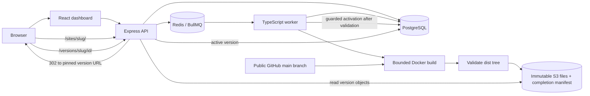

# Architecture

## Deployment lifecycle

1. The API validates a project name and public HTTPS GitHub URL. Repository credentials, arbitrary build commands, branch names, and output paths are not user inputs in this version.
2. PostgreSQL locks the project row, advances its publication generation, and creates a stable deployment ID in `queued` state with that generation. The ID is also the BullMQ job ID. A dispatcher can reconstruct queued jobs from PostgreSQL when enqueueing did not complete.
3. A worker atomically claims a queued row as `building`. Existing non-queued rows are not started again by ordinary duplicate job delivery.
4. The worker creates a Docker container with a fresh `/work` volume and fixed image/commands. Checkout and build run inside that container. Platform database/S3 credentials and the Docker socket are not passed to it.
5. The worker copies `dist` out, validates its full tree, requires `index.html`, rejects unsupported entries and the reserved manifest name, and enforces file-count and byte limits. Files go under `deployments/<deployment-id>/` with conditional `If-None-Match: *` writes. The worker reads each uploaded object back and checks its actual byte length and SHA-256.
6. After every file passes, the worker writes `__shipyard_manifest.json` last, also without overwrite. The manifest records the deployment ID, sorted file keys, sizes, SHA-256 values, and total bytes. A partial prefix without this marker is not a complete new version.
7. A transaction locks the project, changes the deployment from `building` to `deployed`, and stores its manifest. It changes the active pointer only if the project's generation still matches the deployment. A superseded successful build remains a retained `deployed` version. A failed build leaves the pointer intact. Temporary workspaces and containers are cleaned on normal completion.
8. The active site route selects a deployment once and redirects to its immutable version path. Subsequent relative asset requests stay pinned to that version even when the active pointer changes.

Queue wait covers creation to claim. Build duration covers claim to completion, including checkout, dependency installation, output validation, upload, and remote checksum verification. These measurements describe different phases and must not be combined into a single build metric.

## Publication ordering and rollback

The policy is **latest requested build**, not latest successful completion. Deployment creation advances the project generation immediately. If A starts, B is requested, and B fails, a later successful completion of A is retained but cannot replace the existing active site. This avoids publishing an earlier request after the operator has requested a newer one.

Restore accepts only a `deployed` version belonging to the project. Before changing database state, it compares the completion manifest with the manifest saved in PostgreSQL and rechecks every listed object's actual SHA-256 and size. A changed marker, missing object, corrupt object, or invalid manifest rejects restore without changing the active selection. Legacy milestone 1 versions have an explicit compatibility path described below.

Once validation succeeds, the rollback transaction locks the project row, checks the target again, advances the project generation, and updates the active pointer. Earlier queued or running builds may finish, upload, and remain in history, but their older generations cannot publish. A deployment requested after rollback receives a newer generation and may publish normally.

Deployment creation, activation, and rollback serialize through the same PostgreSQL project-row lock. The committed database order defines which action wins. HTTP arrival time or the time a rollback starts object validation does not define that order. A completion racing with rollback either becomes active first and is then replaced, or observes rollback's newer generation and remains retained.

## Persistence boundaries

PostgreSQL is authoritative. Redis AOF retains queue data, but the queue is not the deployment-history database. Object storage is separate from both. Named volumes persist all three local services. No backup or retention guarantee is implemented.

Per-deployment immutable prefixes and a completion marker prevent an incomplete new upload from becoming a served version. The PostgreSQL manifest is recorded only after the marker exists. This is a publication boundary, not a transaction spanning PostgreSQL and S3: a crash can leave complete or partial unused objects before database completion.

Generation checks guard project action order. They are not worker-ownership fencing tokens. Claim expiry, safe retry, stale-worker fencing, and crash cleanup remain milestone 3. A crash can strand a building row, leave a temporary container, or leave an incomplete unused prefix. Do not manually republish a partial prefix or reset a building row while an old worker may still run.

## Migration compatibility

Migration `002_version_selection.sql` adds generation columns and a nullable deployment manifest. It orders existing deployments by creation time and ID for the generation backfill, without replacing deployment IDs, history, logs, or active pointers. Startup migrations run under a PostgreSQL advisory transaction lock.

| Existing milestone 1 data | Milestone 2 behavior |
| --- | --- |
| Project and deployment history | Preserved; no destructive reset |
| Active deployment pointer | Preserved, including serving its existing version |
| Successful version without a manifest | Remains accessible as a legacy version; restore verifies and seals it lazily |
| Legacy `NULL` database manifest | Backfilled only when that successful version is restored |
| Missing legacy index or altered remaining legacy objects | Restore rejected; active pointer and generation unchanged |
| Additive columns after application downgrade | Left intact; no automatic database downgrade |

Legacy serving is restricted to already persisted successful deployments. It is not a way to publish an unfinished new upload. For restore, the compatibility path lists the old prefix, validates required `index.html`, bounds its file count and size, and reads its objects. Each object's actual SHA-256 must match the metadata recorded by milestone 1. It then creates the completion marker and records the manifest during rollback. The reserved marker file is not exposed as a site artifact.

Milestone 1 stored no complete file list. Legacy discovery cannot detect an asset deleted before discovery when the index and remaining objects still validate. Rebuild a legacy version to obtain the full milestone 2 completeness guarantee.

**Coordinated application stop is required.** Stop both API and worker, wait for graceful worker shutdown, update and build the code/images, then start both new processes. Keep backing services and volumes. Old API/worker code ignores generations and is unsafe to mix with milestone 2 processes. The README contains the upgrade commands.

For an application downgrade, stop both new processes before checking out and rebuilding the older commit. Keep the additive columns. The old application resumes its older completion-order and mutable-write behavior; it does not preserve milestone 2 publication guarantees. Do not attempt a rolling downgrade or automatic schema reversal.

## Build threat model

This is a local, single-operator demo for trusted repositories. A public repository is not inherently trustworthy. `npm ci` can execute install scripts, and `npm run build` executes repository code.

Default build limits are 1 CPU, 512 MiB memory, 128 PIDs, and 300 seconds for checkout, build, output copy, and upload, with concurrency 1. Upload requests use the remaining deadline as an abort signal; local output validation and final cleanup can extend total worker time. Output limits are 64 MiB and 5,000 files; persisted logs are capped at 1 MiB per deployment. Verify Docker's host-kernel resource support before relying on configured bounds. No measured capacity is implied.

Build containers receive no platform secrets or Docker socket. The worker needs the Docker socket to create them and therefore has privileged control over the Docker host. Run this platform on a dedicated development host. Builds can access the network; there is no hostile-code network isolation, VM boundary, checkout-size quota, or dependency disk quota. Container resource limits alone do not prove a secure sandbox.

The API has no authentication or ownership checks through milestone 2. Compose exposes its ports only on loopback. Do not publish this configuration to an untrusted network.

## Browser serving boundary

`/sites/<slug>/` responds with a `302` and `Cache-Control: no-store`, targeting `/versions/<slug>/<deployment-id>/`. Version URLs never follow a later active-pointer change. The document and relative assets therefore come from the same deployment during a release or restore.

Because those paths share the dashboard host, deployed documents receive a Content Security Policy sandbox without `allow-same-origin`. Static asset responses permit cross-origin loading so sandboxed JavaScript modules can load. The deployed document cannot use dashboard cookies, local storage, service workers, or same-origin browser APIs.

Repositories must build relative asset URLs. Extensionless version paths fall back to `index.html`; missing paths with file extensions return 404. Client-side routers need the immutable version base, and relative assets need care on nested routes. Hash routing is the simplest supported choice. Separate origins, host-based routing, and a new browser-isolation review belong to milestone 4.
