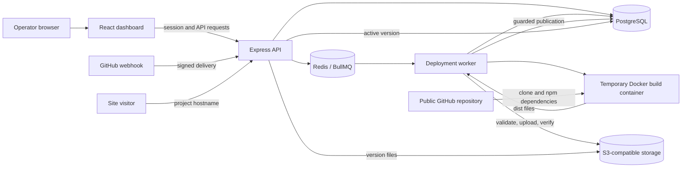
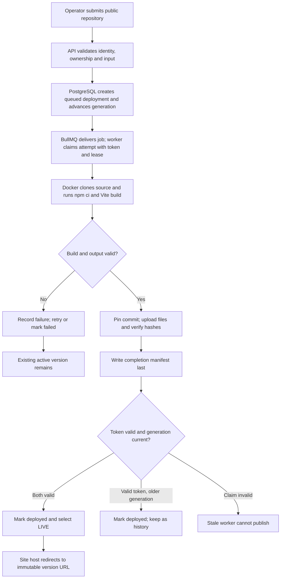
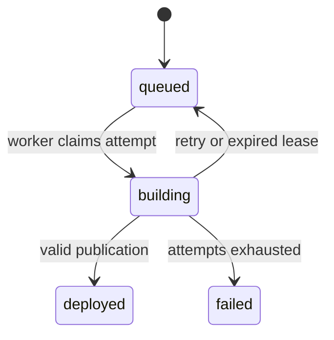

# Shipyard: system design and interview study guide

This guide describes the implementation at commit `7b67df5`. It separates implemented behavior from observations and proposed improvements. Start with the overview, trace one deployment, then use the questions to practice explaining the design in your own words.

For question-by-question sample answers, see [INTERVIEW_ANSWERS.md](INTERVIEW_ANSWERS.md).

## 1. What Shipyard does

Shipyard is a self-hosted platform that turns a supported public GitHub repository into a static website. An operator submits a repository; Shipyard queues a deployment, builds it in a Docker container, stores the resulting files, and serves the selected version. A dashboard shows progress, history and logs. Operators can restore an earlier version without rebuilding it.

Think of it as a small, focused version of a static-site deployment platform. Shipyard itself is the platform. The Nike/Vite repository used during verification was **input** to Shipyard, not Shipyard's own source code.

The supported recipe is intentionally narrow: public HTTPS GitHub repository, root `package-lock.json`, `main` branch, `npm ci`, `npm run build -- --base=./`, and `dist/index.html`. The resulting HTML, JavaScript, CSS and images are served as static files. Shipyard does not run arbitrary user backend servers.

## 2. Concepts before the architecture

| Concept | Plain-language meaning | Its role here |
| --- | --- | --- |
| Git repository | A versioned collection of source files | Input to a deployment |
| Commit SHA | Identifier for a Git revision | Records which source was built |
| Static site | Files a browser can download without a custom server running the site's application code | Shipyard's output |
| Build | Converts source and dependencies into files ready for a browser | Vite produces `dist/` |
| API | HTTP interface used by clients to request actions or data | Express handles project and deployment operations |
| Database | Durable structured records | PostgreSQL stores projects, deployments and the active selection |
| Queue | A way to hand background work to a worker | BullMQ uses Redis to schedule build jobs |
| Container | An isolated process with its own filesystem view and resource controls | Each attempt runs a fixed build in Docker |
| Object storage | Stores named objects rather than database rows | S3-compatible storage holds versioned site files |
| Reverse proxy | Receives HTTP requests and forwards them to a service | Nginx is an optional public-host entry point |
| Domain / DNS | A name and the system that resolves it to an address | Project subdomains identify sites |

Local development uses SeaweedFS as its S3-compatible storage; that does not mean it uses Amazon S3. The Docker images and npm dependencies come from their respective registries, while the submitted repository comes from GitHub.

## 3. System design: components and data flow

| Component | Responsibility | What it does not own |
| --- | --- | --- |
| React dashboard | Forms, deployment history, controls and polling logs | It does not execute builds |
| Express API | Authentication, validation, project operations, webhooks and site routes | It does not make Redis authoritative |
| PostgreSQL | Durable state, ownership, ordering, leases and active pointer | It does not store all site files |
| Redis/BullMQ | Delivers background jobs | It does not decide which worker may publish |
| Worker | Claims attempts, runs builds, uploads and maintains resources | It does not receive API authentication secrets in Compose |
| Docker builder | Checks out and builds the submitted project | It does not receive the Docker socket or platform secrets |
| SeaweedFS/S3 | Stores immutable artifacts and completion manifests | It does not decide which deployment is live |

Code map: [`src/api.ts`](../src/api.ts), [`src/db.ts`](../src/db.ts), [`src/queue.ts`](../src/queue.ts), [`src/worker.ts`](../src/worker.ts), [`src/build.ts`](../src/build.ts), [`src/storage.ts`](../src/storage.ts), [`src/routing.ts`](../src/routing.ts), [`dashboard/src/App.tsx`](../dashboard/src/App.tsx), [`compose.yaml`](../compose.yaml).

## 4. A deployment, step by step

1. The user signs in with a configured operator key. The browser receives a signed, host-only session cookie.
2. The dashboard sends the project name and repository URL to the API. The API validates the input and records a queued deployment with a UUID.
3. The database increments the project's publication generation. A generation is an ordering number for deployment and restore requests.
4. BullMQ delivers a job. The worker claims an attempt in PostgreSQL, receives a unique token and starts renewing a lease.
5. A temporary, resource-limited Docker container clones the repository and runs the fixed install/build recipe. The container's work volume is separate from the platform's persistent storage.
6. The worker validates output paths and limits, pins the Git SHA after the first completed Docker build, uploads the artifacts, and reads them back to verify size and SHA-256. It writes a completion manifest last.
7. PostgreSQL checks the worker's token/lease and the project's generation before publication. A successful current generation becomes LIVE; a successful older generation remains in history without taking over.
8. The visitor opens the stable project URL. Shipyard redirects to a URL containing the selected deployment ID; its relative assets continue to point at that version.

The temporary build container, work volume and workspace are cleaned up on the normal path. Uploaded artifacts, deployment history and logs persist in their respective stores. Cleanup after failures is bounded and best effort.

### The actual local example

During the browser demo, Shipyard cloned the public `adrianhajdin/nike_landing_page` repository and built reviewed commit `cfda8c5841b6e57f644f19aa10c4329553162a15`. Successful deployment A (`a904a9f1`) took 16 ms to first claim and about 20.47 seconds from first claim to completion. B (`d66f47ee`) took 16.792 ms and about 24.80 seconds respectively. Each produced 35 files totaling 3,282,526 bytes. Both were built from the same commit; their deployment IDs identify different versions, not different content. A was kept and restored after B became live.

The initial attempt (`f48cfdcc`) failed because the local cached Docker CLI was damaged. After a targeted cache repair, both subsequent builds succeeded. Full context and screenshots: [RESULTS.md](RESULTS.md#local-http-browser-verification).

## 5. Deployment states and timing

`deployed` means a successful version exists. `LIVE` is a separate designation: PostgreSQL currently selects that version for the stable site URL. A successful version may be deployed but not live.

**Queue wait** is deployment creation to the first worker claim. The API's `buildDurationMs` is elapsed time from the first claim to terminal completion. It includes checkout, installation, build, validation, upload, cleanup and, when applicable, retries, backoff and downtime. It is not isolated compilation time. Attempt records provide additional timestamps.

## 6. Failure, concurrency and recovery

### Why both Redis and PostgreSQL?

Redis/BullMQ helps deliver work. PostgreSQL is the source of truth for whether work is eligible, who owns an attempt, and which version is live. If queue delivery is duplicated or lost, database conditions and a dispatcher protect/reconstruct the work. This is not a claim of exactly-once message delivery; it is guarded state transitions despite possible duplicate delivery.

### Leases and fencing

A **lease** is a time-limited claim. The default is 30 seconds, renewed every 10 seconds. Each claim has a unique token. Every sensitive update checks both token and expiry. If a worker crashes or loses its lease, recovery can schedule another attempt; an old worker cannot publish after its claim becomes invalid. This is **fencing**: the database rejects a stale owner even if that process continues running.

Expired claims and ready queued work are scanned every five seconds. By default there are at most three attempts, with exponential backoff starting at one second. Temporary resources and failed-attempt objects are cleaned up in bounded maintenance batches. An orphaned container may overlap a replacement until timeout or cleanup, so worker concurrency is not a strict global machine-wide container limit.

### Latest request wins

Suppose version X is live, A starts building, and B is requested afterwards. B advances the generation. If B fails and A later succeeds, **X stays live**; A is available in history, but cannot supersede B's newer request. This behavior is a deliberate policy, not latest-successful-completion behavior.

### Restore while a build is running

Restore verifies the target manifest and all listed stored files before changing the active pointer. A transaction locks the project, rechecks the target and advances the generation. Earlier builds can finish, but their old generation cannot undo the restore. New requests after restore can become live normally. PostgreSQL lock/commit order—not HTTP arrival time—determines the winner.

### Atomicity across storage and database

There is no distributed transaction across PostgreSQL and S3. A crash can leave unselected files. The completion marker is written only after verification, and PostgreSQL commits a manifest and active pointer only under valid guards. Attempt-specific prefixes prevent stale attempts from overwriting one another. Cleanup later revisits unused prefixes.

## 7. Security and operational boundaries

- **Authentication and ownership:** configured operator tokens establish identity. Management routes check project ownership. Browser sessions are signed, HttpOnly, host-only and SameSite=Strict; HTTPS selects a Secure `__Host-` cookie. There is no signup, SSO or ownership-transfer interface.
- **Input validation:** operators cannot supply arbitrary shell commands, build paths or branch names. Commands use argument arrays. The allowed GitHub URL and artifact paths are validated.
- **Docker limits:** defaults are 1 CPU, 512 MiB memory, 128 PIDs and 300 seconds per attempt; the builder has no platform secrets or Docker socket. Limits are not proof that hostile code is safely isolated.
- **Trust boundary:** the worker does have Docker socket access and can control the host. Repository install/build scripts execute code with network access. Use trusted repositories on a dedicated host. Disk usage for checkout/npm and queue growth have no platform quotas.
- **Site isolation:** project subdomains are separate browser origins. Site hosts cannot access management API or health routes. Versions of one project share its origin. The dashboard-host fallback is sandboxed and has more browser limitations.
- **Webhook authenticity:** GitHub sends a signature over the raw body. The API checks HMAC-SHA256 using a project-specific derived secret, validates the repository/ref and records a delivery ID. Identical duplicates reuse their original result; conflicting reuse is rejected. Delivery arrival order does not prove Git commit chronology.
- **Retention:** disabled by default. When enabled, the active version, manually kept versions and a configured number of newest versions are protected. Deletion uses a database state transition and resumes after interruption. Deleted artifacts have no built-in undelete.
- **Backups:** PostgreSQL metadata, Redis persistence, object storage and private configuration must be backed up as a consistent recovery set. Public DNS/TLS, sustained capacity, and a backup-restore drill remain unverified in this project.

See [ARCHITECTURE.md](ARCHITECTURE.md) for the full threat model, migration compatibility and exact boundaries; see [DEPLOYMENT.md](DEPLOYMENT.md) for operations.

## 8. How big is it?

This is a **medium-sized portfolio systems project**, not just a static landing page. It includes a dashboard, HTTP API, background processing, database schema/migrations, queue, artifact storage, containerized builds, recovery, security, tests and operating documentation. Its fixed recipe and trusted-repository assumption keep its product scope narrower than a commercial deployment platform.

At commit `7b67df5`, `git ls-files` reported **85 tracked files**. Counting text lines with Node's newline split, including blank lines and a possible final empty line: application code (`src/` plus dashboard source, excluding tests) **18 files / approximately 3,234 lines**; tests and fixtures **25 / 2,214**; scripts **5 / 607**; SQL migrations **4 / 97**. These groups do not include every tracked config/documentation file; line count is a size indicator, not a quality or complexity score.

**Evidence:** the recorded CI run passed 39 unit and 40 integration tests; a real Git-to-site smoke checked all artifacts. Two five-request benchmark bursts completed 5/5 each at worker concurrency 1 and 2. They are small, finite samples—not a sustained capacity guarantee. The local browser demo, private-CA HTTPS proxy check and their limits are documented in [RESULTS.md](RESULTS.md).

## 9. How to explain it in an interview

**30-second version:** “Shipyard is a self-hosted static-site deployment platform. An operator submits a public Vite repository; a worker builds it in a bounded Docker container and stores immutable output in S3-compatible storage. PostgreSQL guards which version becomes live, and the dashboard provides logs, history and rollback.”

**Two-minute version:** Add that BullMQ/Redis delivers jobs but PostgreSQL owns deployment state; lease tokens fence stale workers; artifacts are verified before activation; generations enforce latest-request ordering and protect rollback; and signed webhooks, ownership and optional retention complete the management flow. Explain one concrete failure scenario from sections 6–7. Finish with a real result and a limitation: two five-request bursts succeeded at concurrency 1 and 2, but sustained capacity and hostile-code isolation were not established.

**Answer honestly:** Explain your own contribution and any tools or assistance used. Distinguish a test, a manual observation and an untested design intention. Do not claim public production deployment, unlimited scale, exactly-once queue delivery or secure execution of hostile code.

## 10. Interview questions: basic to hard

Use the preceding sections and linked source as the answer key. For each question, practice a short answer, a concrete project example and one trade-off.

### Basic: project and web fundamentals

1. What problem does Shipyard solve?
2. Who is the intended user of Shipyard?
3. What is the difference between Shipyard and a repository it deploys?
4. What is a static website?
5. How does a static website differ from a backend application?
6. What is Git, and why does Shipyard clone a repository?
7. What does a Git commit SHA identify?
8. What is the purpose of `package-lock.json`?
9. What does `npm ci` do in this workflow?
10. What does Vite produce during the build?
11. Why does the build use `--base=./`?
12. What is an API, and why does the dashboard use one?
13. What does the React dashboard show an operator?
14. What is the difference between a project and a deployment?
15. What do queued, building, deployed and failed mean?
16. What does the LIVE label mean?
17. How can a deployment be deployed but not LIVE?
18. What does the Version link do?
19. What does Restore do?
20. What does Keep protect?

### Intermediate: components and deployment flow

21. What happens from clicking Create & deploy to opening a site?
22. Why is the build performed by a worker instead of the API request?
23. What is a background job queue?
24. What roles do Redis and BullMQ play?
25. Why is PostgreSQL still necessary when Redis stores jobs?
26. Which data belongs in PostgreSQL and which belongs in object storage?
27. What does S3-compatible mean? Is SeaweedFS Amazon S3?
28. What is a Docker image, and how does it differ from a container?
29. Why does each build use a separate container and work volume?
30. What are the configured CPU, memory, PID and time limits?
31. Why must `dist/index.html` exist?
32. How are deployment logs displayed and updated?
33. How does the platform calculate queue wait?
34. What does `buildDurationMs` include besides the Vite build?
35. Why are site artifacts stored under versioned paths?
36. What is a stable project URL?
37. Why does the stable URL redirect to a version-specific URL?
38. What happens if an asset path points outside its pinned version?
39. How does the platform handle a build that fails?
40. What happens to temporary build resources after an attempt?

### Intermediate: data, security and operations

41. What is a database migration, and why are these migrations additive?
42. What is a transaction, and where does Shipyard use one?
43. What is a primary key, and why use a UUID for a deployment?
44. What is a session cookie, and what does HttpOnly provide?
45. What do Secure, SameSite and host-only cookies mean?
46. How are projects associated with their owners?
47. Why should an operator key never be committed to Git?
48. Why does the builder not receive platform secrets or the Docker socket?
49. What is the Docker socket, and why is access to it powerful?
50. Why is a public repository not automatically a trusted repository?
51. How does the API validate repository input?
52. Why are user-supplied shell commands outside the supported recipe?
53. What are a hostname, a subdomain and DNS?
54. How does Shipyard choose a project from the HTTP Host header?
55. Why should the dashboard and published sites use different origins?
56. What additional role does Nginx play in a public installation?
57. What is HTTPS and why does a public deployment need certificates?
58. What is a GitHub webhook?
59. Why does Shipyard verify the webhook signature before accepting a push?
60. What must be included in a consistent backup and why?

### Advanced: ordering, retries and reliability

61. What problem occurs if the same queue message is delivered twice?
62. Does Shipyard promise exactly-once message delivery? What does it guarantee instead?
63. What conditions must a worker satisfy to claim an attempt?
64. What is a lease, and why does it need renewal?
65. What happens when a worker crashes while holding a lease?
66. What is a fencing token and which operations check it?
67. Why is a timeout alone insufficient to stop a stale worker publishing?
68. What happens when a worker loses its lease during upload?
69. How do bounded retries and exponential backoff work here?
70. What happens when the maximum attempt count is reached?
71. How is ready work recovered if queue delivery is lost?
72. How can an orphaned build container overlap a retry?
73. What is a publication generation?
74. How do latest-requested-build semantics work when A and B overlap?
75. What happens if B is requested after A but B fails before A succeeds?
76. How does a restore interact with an already running build?
77. Why does project-row locking matter for restore and activation?
78. Why is HTTP arrival time not the source of ordering truth?
79. What does idempotency mean for a GitHub delivery ID?
80. Why can webhook acceptance order differ from Git commit chronology?

### Hard: integrity, trade-offs and design critique

81. Why verify uploaded object sizes and SHA-256 hashes?
82. What is the completion manifest, and why is it written last?
83. Can a crash leave complete or partial objects without a database-selected version?
84. Why are attempt-specific object prefixes important after lease loss?
85. Why is there no single atomic transaction spanning PostgreSQL and S3?
86. What happens if a rollback target's manifest or object is missing or changed?
87. How does retention avoid racing with Keep or restore?
88. Why can a deletion already marked `deleting` continue after retention is disabled?
89. What does the legacy artifact compatibility path guarantee, and what can it not detect?
90. Why must old and new API/worker versions not overlap during a migration?
91. What are the security limits of CPU, memory and PID restrictions?
92. How would you isolate genuinely untrusted builds more strongly?
93. What can go wrong if npm install scripts or build output contain secrets?
94. Why does pinning a manual build after its first completed Docker build leave a crash-before-pin window?
95. How do webhook-pinned SHAs differ from manual-build SHA pinning?
96. What is measured by the two five-request benchmark bursts, and what remains unknown?
97. Why is a five-sample p95 not a reliable production capacity estimate?
98. What would a sustained-load experiment need to measure beyond configured concurrency?
99. How would you test recovery after a crash during artifact upload without risking production data?
100. If asked to make Shipyard production-ready, which three limitations would you prioritize and how would you validate each fix?
